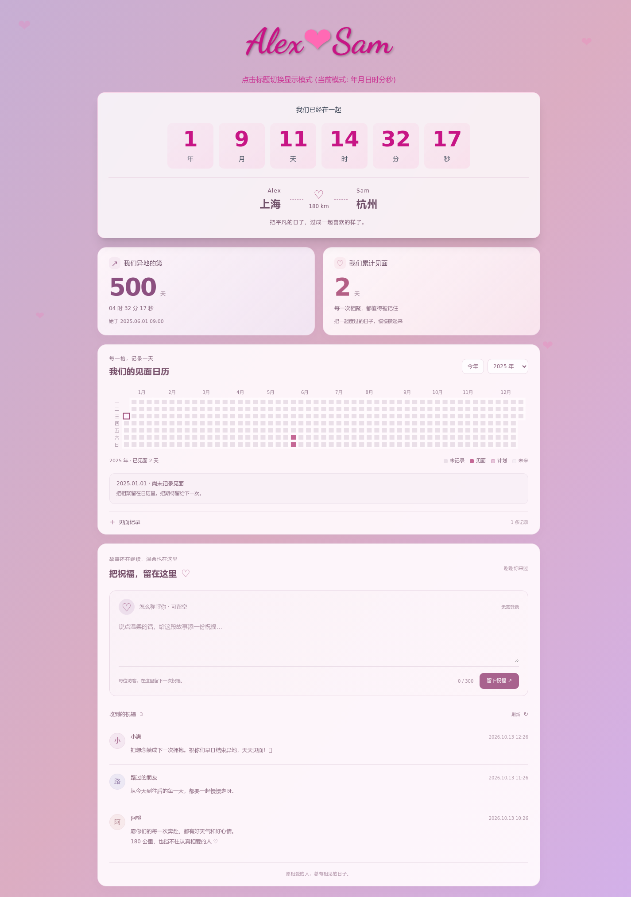

<div align="center">

# Together Days · 一起的日子

**把相爱的时间、每一次相见和朋友的祝福，慢慢记下来。**

一个可以部署到 Vercel 的恋爱纪念页模板。支持多对情侣、异地计时、见面日历、加密留言和密码管理后台。

[](https://github.com/LZJ-I/together-days/generate)
[](https://nodejs.org/)
[](./LICENSE)

[](https://vercel.com/new/clone?repository-url=https://github.com/LZJ-I/together-days)

</div>



[查看手机效果](./docs/images/preview-mobile.png)

> 本仓库中的人物、地点、日期和留言均为演示数据。创建自己的纪念页时，请先替换示例配置。

## 可以记录什么

- **相爱的时间**：点击标题切换 7 种计时模式，切换时卡片高度保持一致。
- **两地的想念**：分别配置地点、距离和多段异地时间，开始当天记为第 1 天。
- **每一次相见**：记录某一天或一段时间，开始和结束精确到分钟，重复日期只累计一次。
- **见面日历**：类似 GitHub 活跃记录的点阵日历，支持年份选择、日期详情和手机横向滚动。
- **朋友的祝福**：可选昵称、文字和表情；同一浏览器或同一 IP 在每个情侣页面只能留言一次。
- **管理后台**：通过 `/admin/` 登录，新增、修改、删除情侣页面，维护记录和删除评论。
- **一套网站，多段故事**：通过域名或 `?site=页面标识` 切换配置。

主页不显示后台入口，直接输入 `/admin/` 即可访问。

## 三种使用方式

| 你想做什么 | 需要配置什么 |
| --- | --- |
| 只展示计时和日历 | 修改 `sites.json` 和 `data/`，直接部署 |
| 在网页里维护内容 | 再配置管理密码、会话密钥和 GitHub 令牌 |
| 开启加密评论 | 再创建评论数据分支，配置独立评论密钥 |

不需要额外数据库服务。页面使用静态文件，登录和评论使用 Vercel Node.js Functions；配置和密文保存在自己的 GitHub 仓库中，仍受平台用量和 API 额度约束。

## 快速开始

1. 点击 **Use this template** 创建自己的仓库。准备保存真实记录时，可以选择私有仓库。
2. 修改 `sites.json` 中的名字、恋爱开始时间和文案。
3. 修改 `data/alex-sam.json` 中的地点、距离和演示见面记录，或关闭不需要的模块。
4. 将自己的仓库导入 Vercel，部署完成后即可访问。

仓库已提供 `vercel.json`：构建命令为 `npm run build`，输出目录为 `public`，无需手动改框架配置。默认不开启评论，因此展示页面不需要密码、令牌或数据库。

### 修改页面内容

```json
{
  "defaultSite": "alex-sam",
  "sites": {
    "alex-sam": {
      "name1": "Alex",
      "name2": "Sam",
      "startDate": "2025-01-01T00:00:00+08:00",
      "motto": "把平凡的日子，过成一起喜欢的样子。",
      "hosts": [],
      "relationshipData": "./data/alex-sam.json",
      "commentsEnabled": false
    }
  }
}
```

| 配置 | 用途 |
| --- | --- |
| `name1` / `name2` | 标题上的两个人 |
| `startDate` | 恋爱开始时间，建议写明时区 |
| `motto` | 你们的一句话 |
| `hosts` | 对应域名；不含 `https://` 或路径，可留空 |
| `relationshipData` | 异地和见面记录文件；移除后不显示该模块 |
| `commentsEnabled` | 是否开放评论；默认关闭，配置好后台后再开启 |

地点、距离、异地阶段和见面记录放在 `data/<页面标识>.json`：

```json
{
  "timeZone": "Asia/Shanghai",
  "locations": { "person1": "上海", "person2": "杭州" },
  "distanceKm": 180,
  "longDistancePeriods": [
    { "startAt": "2025-06-01T09:00:00+08:00", "endAt": null }
  ],
  "meetings": [
    {
      "startDate": "2025-06-07T10:00:00+08:00",
      "endDate": "2025-06-08T18:00:00+08:00",
      "title": "示例：一起度过的周末"
    }
  ]
}
```

`distanceKm` 留空或设为 `null` 时隐藏距离。异地结束时间留空表示持续至今。见面结束时间留空表示单日，范围首尾都计入；旧的 `YYYY-MM-DD` 日期也兼容。未来见面会显示为计划，到开始时间后才计入累计天数。

`sites.json` 与 `data/` 会随网站公开发布，请填写愿意公开的内容。

## 开启管理后台

1. 在 GitHub 创建 **fine-grained personal access token**，只选择自己的站点仓库，赋予 **Contents: Read and write**。
2. 在 Vercel 项目的 **Settings → Environment Variables → Production** 中添加：

| 环境变量 | 内容 |
| --- | --- |
| `ADMIN_PASSWORD` | 自己设置的管理密码，至少 12 个字符 |
| `ADMIN_SESSION_SECRET` | 随机会话密钥，至少 32 个字符 |
| `GITHUB_TOKEN` | 上一步的仓库令牌 |
| `GITHUB_REPOSITORY` | 自己仓库的 `所有者/仓库名` |
| `GITHUB_BRANCH` | 通常填 `main`，与 Vercel 生产分支一致 |

3. 重新部署，直接访问 `https://你的域名/admin/`，输入管理密码。

生成随机密钥：

```sh
node -e "console.log(require('node:crypto').randomBytes(32).toString('base64url'))"
```

后台保存会向主分支提交修改，Vercel 自动部署完成后主页更新。分支保护规则需要允许所配置的账号提交。并发修改不会覆盖新版本，页面会提示先重新读取。

支持新增情侣并生成 `/?site=<页面标识>` 链接。使用独立域名时，需要同时在 Vercel 和 DNS 中完成绑定。删除页面需要输入标识确认，记录归档到不随静态网站发布的 `archive/`；默认页面必须先指定替代项，最后一个页面不能删除。已删除的页面标识不能复用。

管理会话使用 HttpOnly cookie，有效期为 8 小时。修改管理密码或会话密钥会使旧会话失效。当前登录尝试限制在单个函数实例内生效，没有使用分布式限流存储。

## 开启加密评论

1. 在自己的 GitHub 仓库中，从 `main` 新建 **`comments-data`** 分支。它会继承 `vercel.json` 中的禁用部署规则，不要把该分支合并回主分支。
2. 在 Vercel Production 中添加 `COMMENTS_BRANCH=comments-data`。
3. 再生成一个独立的随机密钥，填入 `COMMENT_ENCRYPTION_KEY`。必须使用 **32 字节随机数据的 base64url 编码**，可使用上面的命令，或访问 `/admin/comments-setup.html` 在浏览器中生成。
4. 备份评论密钥并重新部署，在后台为相应情侣开启评论区。

评论先由服务端使用 AES-256-GCM 加密，再写入数据分支的 `comments/<页面标识>.json`。GitHub 中保存的是密文；已公开评论仍可以在网页和公开接口中阅读。昵称、正文和去重标识均在密文内，原始 IP 不保存到仓库。

留言校验和写入在服务端完成，并发冲突会重新读取数据。不同情侣页面的留言资格分别计算。删除评论后默认仍保留一次限制，后台可以单独点击「允许再次留言」。Git 历史仍会保留旧的密文版本。

**已有评论后不要直接替换评论密钥。** 它负责解密旧评论和去重记录，更换时需要先迁移。每对情侣最多保留 400 条记录（包括已删除备份），访客每次读取 20 条。

网页识别的是浏览器标识，不能可靠识别硬件设备；清除浏览器数据并更换 IP 可能绕过限制。同一网络下的不同访客也可能共享 IP。若在 Vercel 前方增加代理，应先核对真实 IP 的传递方式。

## 本地开发与预览

使用 Node.js 22 或更新版本；仓库提供 `.nvmrc`，开发和验证使用 Node.js 24。

```sh
npm ci
npm test
npm run build
```

不连接真实仓库，体验完整页面和管理后台：

```sh
npm run preview:comments
```

- 页面：`http://localhost:8765/`
- 后台：`http://localhost:8765/admin/`
- 仅供预览的密码：`preview-love-only`

示例留言及所有增删操作均保存在内存中，重启命令后恢复，不写入 GitHub。预览会临时打开评论，不会改变 `sites.json` 中的默认开关。

需要连接自己的真实仓库时，复制 `.env.example` 为 `.env.local`，填写配置后运行：

```sh
npm run dev
```

默认访问 `http://localhost:8000/`。填写真实令牌后，本地保存也会提交到所配置的 GitHub 仓库。

## 项目结构

```text
admin/             密码管理后台与配置说明
api/               Vercel Functions 入口
assets/            页面样式、脚本、字体和日历模块
charts/            日历图表源码
server/            登录、GitHub 存储与评论加密
scripts/           构建、本地开发和内存预览
sites.json         多情侣配置
data/              公开的异地与见面记录
tests/             时间计算、存储、权限和并发验证
```

`npm run build` 会生成 `public/` 发布目录，它不提交到 Git。只允许浏览器资源进入发布目录，服务端源码、环境变量和归档记录不会复制进去。页面字体保存在本地，日历使用按需打包的 ECharts SVG 渲染模块。

## 许可与致谢

项目代码使用 [ISC License](./LICENSE)。第三方组件和字体保留各自的许可，见 [THIRD_PARTY_NOTICES.md](./THIRD_PARTY_NOTICES.md)。

感谢 [ECharts](https://echarts.apache.org/)、[Luxon](https://moment.github.io/luxon/)、[Tailwind CSS](https://tailwindcss.com/) 和 Dancing Script。
